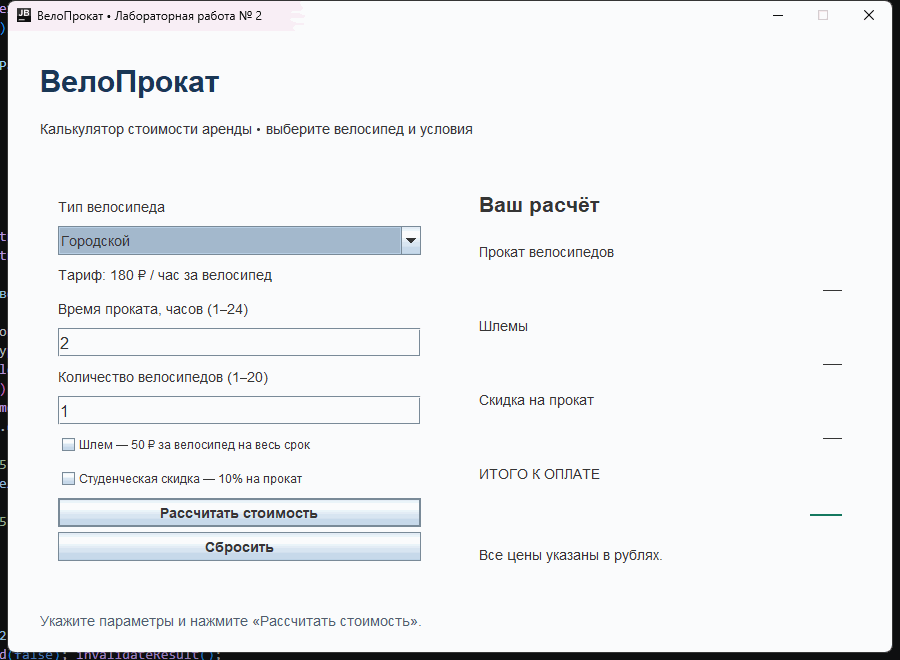

# Лабораторная работа № 2 — ВелоПрокат

Приложение на Java Swing для расчёта стоимости проката велосипедов.

## Расчёт

Выберите тип велосипеда, введите время от 1 до 24 часов и количество от 1 до 20. При необходимости добавьте шлем и студенческую скидку, затем нажмите «Рассчитать стоимость» или Enter.

- Городской велосипед: 180 ₽/час.
- Горный велосипед: 250 ₽/час.
- Электровелосипед: 400 ₽/час.
- Шлем: 50 ₽ за велосипед на весь срок.
- Студенческая скидка: 10% от стоимости проката без шлемов.

Итого = тариф × часы × количество + шлемы − скидка.

Например, два горных велосипеда на 3 часа со шлемами и скидкой стоят 1450 ₽.

Ошибки ввода отображаются внизу окна. Изменение параметров очищает предыдущий результат. Кнопка «Сбросить» возвращает начальные значения.

## Структура

- `src/Main.java` — запуск приложения.
- `src/RentalApp.java` — графический интерфейс и обработчики событий.
- `src/RentalCalculator.java` — тарифы и расчёт стоимости.
- `demo.gif` — демонстрация работы приложения.
